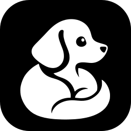
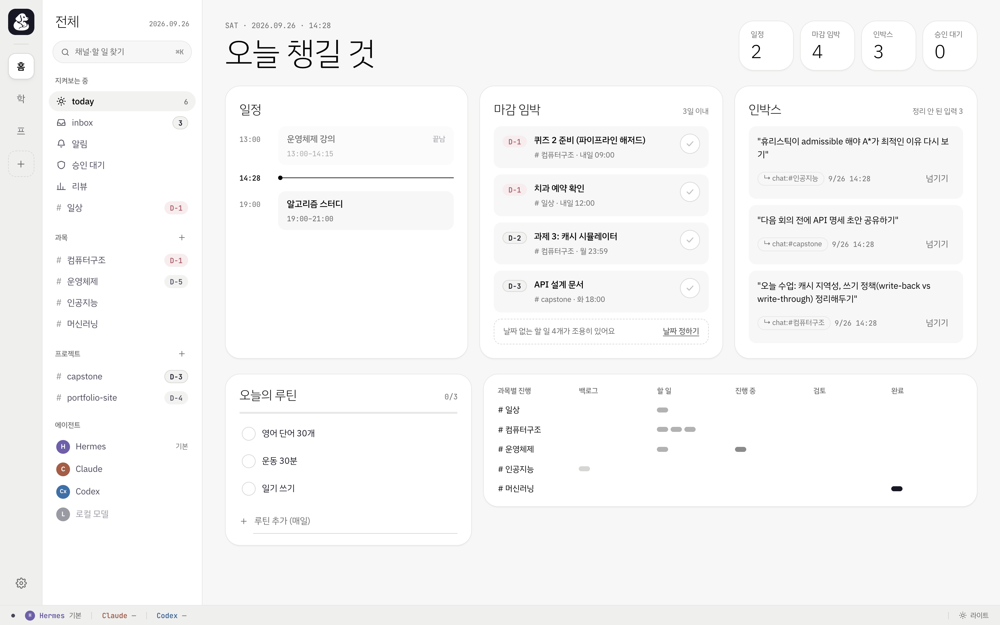
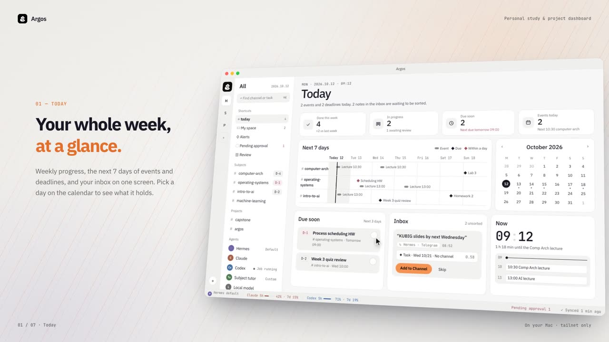
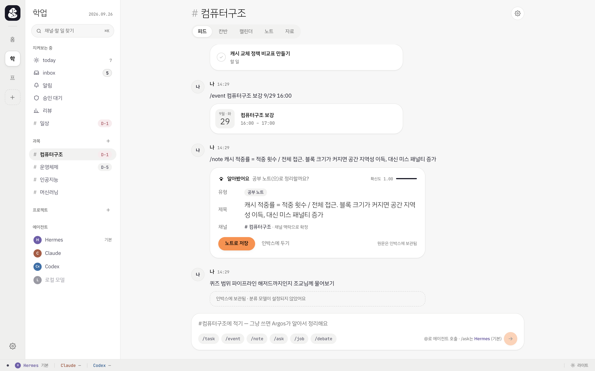
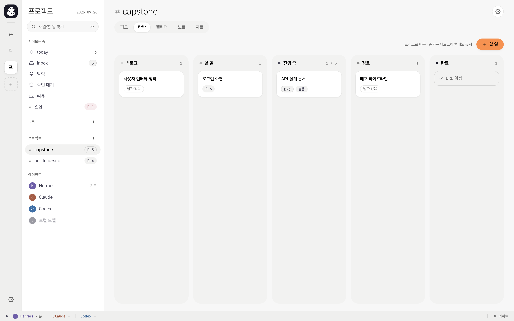
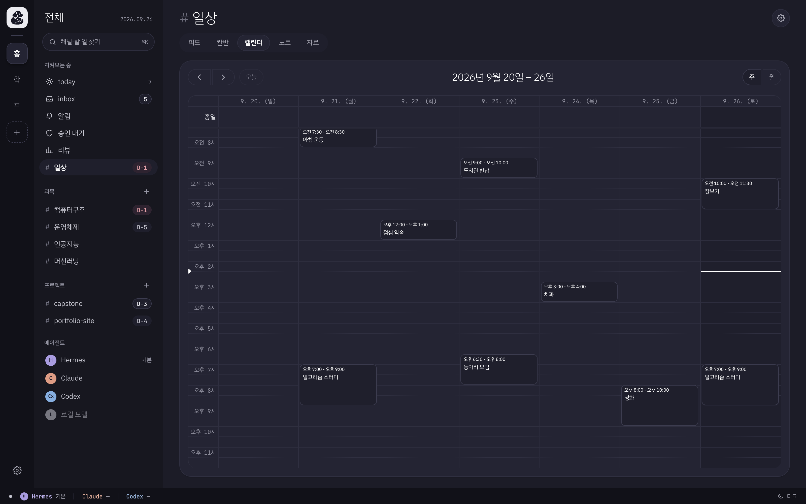
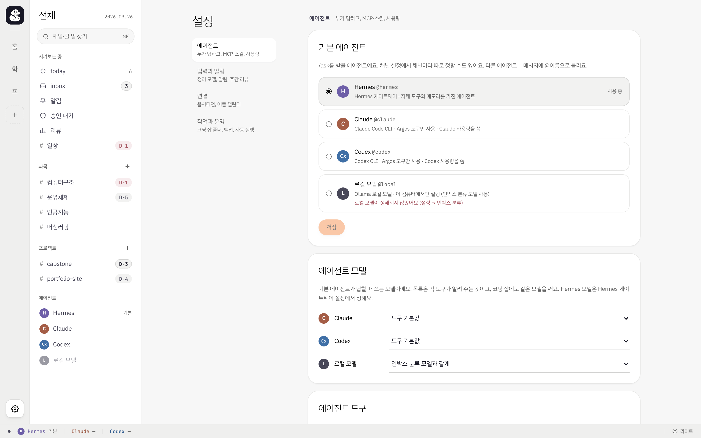
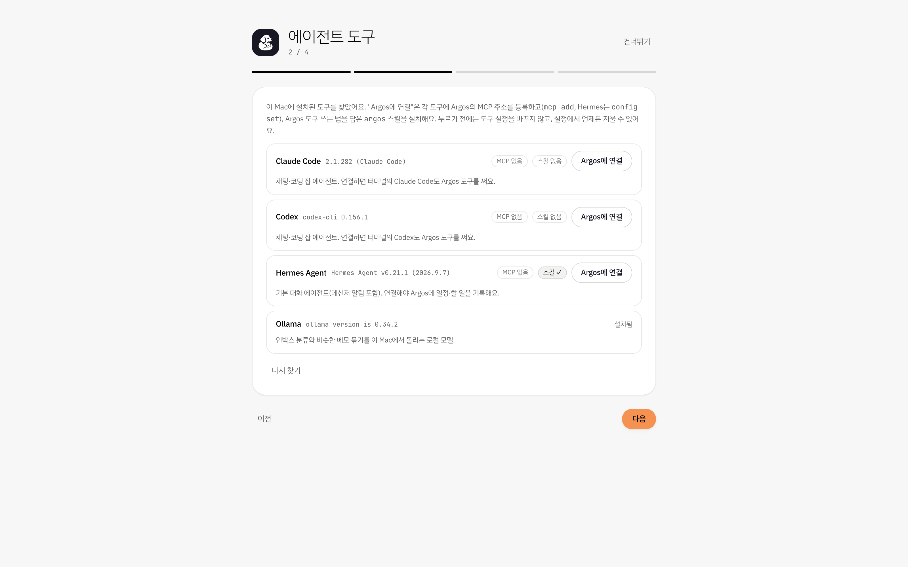

<div align="center">



# Argos

**A local-first desk for school and side projects — schedules, tasks, notes and AI agents in one place.**

**English** · [한국어](README.ko.md)

[](https://github.com/sciencemj/argos/actions/workflows/ci.yml)
[](https://github.com/sciencemj/argos/releases/latest)


<picture>
  <source media="(prefers-color-scheme: dark)" srcset="docs/images/today-dark.png" />
  
</picture>

</div>

[](https://sciencemj.github.io/argos/#video)

Latest intro video (83 s): [Watch on the intro site](https://sciencemj.github.io/argos/#video) · MP4 ([English](https://sciencemj.github.io/argos/media/argos-intro.en.mp4) · [한국어](https://sciencemj.github.io/argos/media/argos-intro.ko.mp4)) · Interactive HTML ([English](https://sciencemj.github.io/argos/media/argos-intro.en.html) · [한국어](https://sciencemj.github.io/argos/media/argos-intro.ko.html))

Every course and project gets its own channel with chat, a kanban board and a calendar. Channels open
straight into a fresh chat: write things down the way you would text a friend — *"quiz on Friday"*,
*"send the API draft before the meeting"* — and Argos files them as tasks, events or notes. Your
connected AI models or agents (Hermes, Claude Code, Codex) work in the same place across threads
and sidebar session trees, and read or write your schedule through Argos' built-in tools and MCP server.

Everything runs on your Mac. The app binds to `127.0.0.1` only, keeps its data in
`~/Library/Application Support/Argos`, and stores secrets in the macOS Keychain.

> [!NOTE]
> The interface supports Korean and English. Choose a language during setup or in Settings ([한국어 README](README.ko.md)).

## Features

**Organize**
- **Channels per course and project**, grouped into areas, plus **Today** and **My Space**. Both channels and
  My Space default to chat with a sidebar session tree, while My Space's inbox sorts captures into personal tasks, events and notes.
- **Feed first**: plain messages land in the inbox and are sorted by a local model (Ollama) or Hermes into
  tasks, events and notes; slash commands (`/task`, `/event`, `/note`, `/ask`, `/job`, `/debate`) skip the guessing.
- **Kanban** with WIP warnings and drag and drop, **calendar** (week and month) with recurring events,
  **Today** with weekly progress, the next 7 days of events and deadlines, a month calendar, the inbox
  and daily routines.
- **Obsidian vault**: full-text search, notes per channel, checkbox tasks synced both ways (Tasks and
  Dataview syntax), with backups before every edit.
- **Calendars**: an ICS feed for any calendar app and two-way iCloud (CalDAV) sync.
- **School LMS (LearningX)**: a browser extension brings in assignments, announcements and materials.
  Assignments become tasks with their deadline, and long notices show up in the feed as cards summed up by AI
  ([setup](docs/lms-extension.md)).
- **Notices and weekly review**: deadline and stale-inbox notices in the app, as macOS notifications
  or through Hermes to your messenger; weekly reviews are available on the Review page.
- **Model providers**: register Anthropic, Google (Gemini API), OpenAI-compatible servers, or Ollama — keep a
  small classifier on this Mac and run bigger models on a GPU box in your network or a cloud service. Custom
  agents and the inbox classifier each pick one; settings label each as this device, your network or cloud.
- **Channel workspace & knowledge search**: upload files into a channel's workspace (`uploads/`) or link a
  folder on your Mac; uploaded files and synced LMS course materials are indexed with SQLite FTS5 so agents
  can search them via `search_knowledge`, with indexing status shown in the workspace panel.
- **Private chat**: a ghost button in a local model's DM switches to a conversation Argos never stores —
  no database rows, no files, no logs — for work you must not leak. Text and files go only to models on this
  device or your network, and the chat lasts while the app is open.
- **Morning digest**: at the hour you pick, the agent you choose gathers today's events, deadlines and new
  LMS posts into a briefing in a #today thread and sends the same text to your messenger. Reply to keep talking.

**Work with agents**
- **Chat without agents · model picker · memory**: connect a model and chat right away with no agent setup;
  pick the model and reasoning level in the composer. Default chat keeps a main memory (`remember`/`recall`),
  while `@mentioned` agents keep their own.
- **Native harness + external agents**: run Argos' built-in agent harness (Anthropic, Google Gemini,
  OpenAI-compatible, Ollama) alongside **Hermes, Claude Code, and Codex** in chat-first channels, sidebar
  session trees, and 1:1 chats.
- **31 built-in tools · permissions · plugins**: native agents use 20 Argos domain tools (including
  `remember`/`recall`), 8 workspace file/shell tools, inline visuals (`render_artifact`), agent delegation
  (`ask_agent`), and web fetching (`web_fetch`). Consecutive tool calls fold into one line, per-channel
  `auto_edit` / `ask` modes and inline approval cards gate actions, and `data_dir/plugins/*.py` loads custom
  Python tool plugins.
- **Attachments**: paste, drop or pick images, PDFs and text files, and agents read them.
- **Coding jobs**: `/job` on a card runs Claude Code or Codex in an allowed folder and reports back on
  the card (todo → in progress → review).
- **Custom agents** with their own prompt, model and tool whitelist, importable as YAML, and
  **debates** between agents with a moderator.
- **MCP server** at `/mcp`: agents list channels, add tasks and events, capture notes, create new course
  or project channels; deletions wait for your approval.
- **Plan usage** for Claude and Codex in the status bar.

**Desktop app**
- Menu bar app: closing the window keeps sync, jobs and notices running.
- **Quick capture** anywhere with <kbd>⌘</kbd><kbd>⇧</kbd><kbd>Space</kbd>, straight into the inbox.
- **Open on your phone**: with Tailscale on this Mac, one switch in Settings opens Argos on phones and iPads
  in your tailnet (PWA). Only Tailscale accounts you allow get in, and it never opens outside your tailnet.
- **First-run setup** that finds your agent tools and connects them (MCP + an `argos` skill) in one click.
- **Korean and English interface**: choose a language during setup or in Settings. Argos uses your device's preferred language on first launch and remembers your choice.
- **Automatic updates**, signed and checked against the public key built into the app.
- **Clean uninstall** that also removes what Argos added to your agent tools, login items and Keychain.

## Screenshots

| Channel feed | Kanban |
|---|---|
|  |  |
| **Calendar** | **Settings** |
|  |  |
| **First-run setup** | **Quick capture** (<kbd>⌘</kbd><kbd>⇧</kbd><kbd>Space</kbd>) |
|  |  |

## Install

1. Download `Argos_<version>_aarch64.dmg` from the [latest release](https://github.com/sciencemj/argos/releases/latest).
2. Open it and drag **Argos** into **Applications**.
3. The first time, **right-click Argos → Open**. The app is ad-hoc signed (no paid Apple developer
   certificate), so a double click shows an "unidentified developer" warning.
4. Follow the welcome screen: choose a language, check and connect your tools, pick defaults, and turn on start at login if you want it.

Updates arrive on their own: Argos checks GitHub Releases every six hours, installs a new version in
the background and applies it on the next restart (or from the menu bar right away).

### Optional tools

Argos works on its own; each tool adds more.

| Tool | Adds | Get it |
|---|---|---|
| [Claude Code](https://docs.claude.com/en/docs/claude-code) | Chat and coding-job agent, plan usage | `npm install -g @anthropic-ai/claude-code` |
| [Codex](https://github.com/openai/codex) | Chat and coding-job agent, plan usage | `npm install -g @openai/codex` |
| Hermes Agent | Chat agent, messenger notices | see [docs/hermes-setup.md](docs/hermes-setup.md) |
| [Ollama](https://ollama.com/download) | Local inbox sorting and note grouping | install, then pick a model in settings |
| [Obsidian](https://obsidian.md) | Notes and checkbox tasks per channel | pick your vault in settings |

### Connecting your agents

**Settings → Agents · Models → Tool integrations → "Connect to Argos"** registers Argos' MCP server — via
each tool's CLI for Claude Code, Codex, Hermes and `agy`, or by updating `~/.gemini/antigravity/mcp_config.json`
directly for Antigravity IDE — and installs an `argos` skill that explains when to use it. The same card
removes either one again.

| Tool | MCP | Skill |
|---|---|---|
| Claude Code | `claude mcp add --transport http --scope user argos …` | `~/.claude/skills/argos` |
| Codex | `codex mcp add argos --url …` | `~/.codex/skills/argos` |
| Hermes | `hermes config set mcp_servers.argos.url …` | added to `skills.external_dirs` |
| Antigravity (`agy` / IDE) | `agy mcp add --type http argos …` (IDE: `~/.gemini/antigravity/mcp_config.json`) | `~/.gemini/config/skills/argos` (IDE: `~/.gemini/antigravity/…`) |

After an update, Argos refreshes the skills and MCP addresses it installed — and never re-adds what you removed.

## Privacy and security

- The server listens on `127.0.0.1:8000` only; nothing is exposed to your network.
- Your data stays in `~/Library/Application Support/Argos` (SQLite, daily backups).
- The iCloud app-specific password and model provider API keys live in the Keychain; the Hermes key is read from Hermes' own
  `.env`; Claude and Codex use their own logins. Argos never stores or logs OAuth tokens.
- Text leaves your Mac only through the agents and models you choose (model providers outside your
  network and Ollama `*-cloud` models are labeled as such in settings).
- Agents cannot delete anything directly: deletions through MCP become approval requests.

## Development

Requirements: [uv](https://docs.astral.sh/uv/), [bun](https://bun.sh), and for the desktop app Rust
(rustup) and the Xcode command-line tools.

```bash
make install      # uv sync + bun install
make dev          # backend :8100 + frontend :5273 (Vite proxies /api and /ws)
make test         # pytest + vitest
make lint         # ruff, pyright (strict), biome, tsc
make api-types    # regenerate frontend/src/api-types.ts after changing API models
make app          # desktop app → desktop/build/Argos.app and Argos.dmg
make release VERSION=x.y.z   # bump, tag and push; CI builds, signs and publishes
```

Port 8000 belongs to the installed app (agents' MCP entries point there), so the development server
uses 8100/5273 and both can run at once. Development data lives in `backend/data`.

### Architecture

```
backend/    FastAPI + async SQLAlchemy (SQLite WAL), Alembic migrations
  src/argos/services.py       the single write path: activity log + WebSocket events
  src/argos/chat.py           routing a message: thread, @mention, slash command or inbox
  src/argos/runner.py         agent runs and coding jobs, streamed over WebSocket
  src/argos/harness.py        native agent harness: tool loop, permissions, OpenAI/Anthropic
  src/argos/argos_tools.py    Argos domain tools shared by native harness and MCP
  src/argos/file_tools.py     workspace file and shell tools with path guards and backups
  src/argos/plugins.py        custom tool plugin loader (data_dir/plugins/*.py)
  src/argos/knowledge.py      channel workspace uploads and FTS5 trigram knowledge index
  src/argos/approval_waits.py inline tool-approval wait registry
  src/argos/agents.py         adapters: native harness, Hermes, Claude Agent SDK, Codex, Ollama
  src/argos/mcp_server.py     the MCP server external agents use
  src/argos/sft_export.py     SFT trajectory exporter (CLI & local /api/v1/sft/export)
  src/argos/desktop.py        entry point of the server inside the desktop app
frontend/   React 19 + Vite + Tailwind v4 + TanStack Query
desktop/    Tauri 2 shell: sidecar server, menu bar, quick capture, updater
integrations/  the argos skills installed into agent tools
training/   synthetic seed generator, Unsloth QLoRA + W&B training, tool-calling eval
```

More in [docs/PLAN.md](docs/PLAN.md) (design and phases), [docs/desktop.md](docs/desktop.md) (the
app, updates and releases), [docs/mcp-setup.md](docs/mcp-setup.md) (MCP tools),
[docs/sft-training.md](docs/sft-training.md) (SFT export, training and eval), and
[docs/decisions.md](docs/decisions.md) (decisions made along the way).
